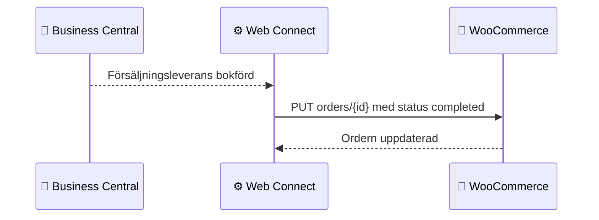

# Från Business Central till WooCommerce: färdigställda order

När en försäljningsleverans för en order från WooCommerce bokförs i Business Central sätter Web Connect ordern till slutförd (completed) i WooCommerce. Bara leveranser för order som kom från WooCommerce skickas.

| | |
|---|---|
| **Riktning** | Business Central → WooCommerce |
| **Startas av** | En bokförd försäljningsleverans, via en utgående synktrigger. Triggers ställs in per integration. Oftast är fälten som skickas till WooCommerce också triggerfält, så en ändring i något av dem skickar posten igen |
| **Resultat** | Ordern har status completed i WooCommerce |
| **Del av** | [Business Central och WooCommerce: integration](../overview.md) |

## Steg för steg

1. Ordern skickas och försäljningsleveransen bokförs i Business Central.
2. Web Connect kontrollerar att leveransen hör till en order från WooCommerce.
3. Ordern uppdateras i WooCommerce med status completed.

## Mappning av data

| Fält i Business Central | Fält i WooCommerce | Kommentar |
|---|---|---|
| Fast värde | `status` | Alltid `completed` |
| Order-ID från WooCommerce på leveransen | Ordern i URL:en | Leveranser utan det skickas inte |

## Objekt i Web Connect

| Objekt | Roll |
|---|---|
| `WOC-UPDATE-ORDER-TO-SHIPPPED` | Sätter ordern till completed |

## Alternativ

I upplägget som används i produktion skickas bara statusen, och den första bokförda leveransen sätter ordern till completed. Ett spårningsnummer kan också skickas, och när en order räknas som slutförd kan ställas in per integration.

## Relaterat

- [Business Central och WooCommerce: integration](../overview.md)
- [Order in](order-inbound.md)
