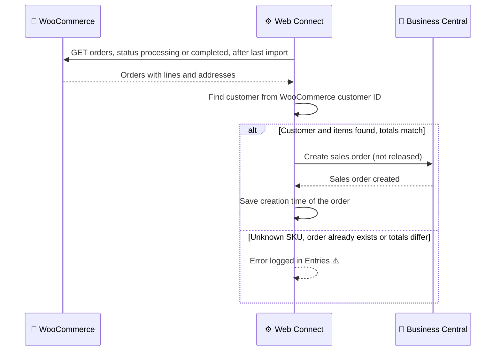

# WooCommerce to Business Central: order inbound

Web Connect fetches orders with status processing or completed from WooCommerce on a schedule and creates a sales order in Business Central for each one. It only asks for orders created after the last imported order, and checks the order total and VAT against WooCommerce.

| | |
|---|---|
| **Direction** | WooCommerce → Business Central |
| **Trigger** | Schedule in the Business Central job queue |
| **Result** | A sales order in Business Central that is not released, with the WooCommerce order number as order number and external document number |
| **Part of** | [Business Central and WooCommerce integration](../overview.md) |

## Step by step

1. The customer places and pays an order in WooCommerce.
2. Web Connect asks WooCommerce for orders with status processing or completed, created after the last imported order. It reads 100 orders at a time, oldest first.
3. The customer is found from the WooCommerce customer ID, among the customers fetched in [Customer inbound](customer-inbound.md).
4. Web Connect creates the sales order with the delivery address and one item line per order line.
5. The order total and the VAT amount are checked against WooCommerce.
6. The creation time of the order is saved, so the next run starts after it.
7. The order is left unreleased, for someone to check in Business Central.

## Data mapping

| WooCommerce field | Business Central field | Note |
|---|---|---|
| `number` | No. and External Document No. | Unique. An order that already exists raises an error |
| `id` | External ID in Web Connect | Used to update the order in WooCommerce later |
| `customer_id` | Sell-to Customer No. | Looked up among the customers fetched from WooCommerce |
| `date_created` | Document Date | Also saved as the starting point for the next run |
| `currency` | Currency Code | The local currency is mapped to blank |
| `shipping` name, company, address, postcode, city, state, country, phone | Ship-to fields | |
| `line_items` `sku` | Item No. on the sales line | Line type is Item |
| `line_items` `quantity` | Quantity | |
| `line_items` `price` | Unit Price | Prices on the order are excluding VAT |
| `total` and `total_tax` | Totals check | Compared with the sales order |

A fixed location can be set on the order, and a location per line can be read from a field on the item.

## Web Connect objects

| Object | Role |
|---|---|
| `WOC-INC-ORDER` | Fetches orders and creates the sales order header |
| `WOC-LINE_ITEMS` | Creates the sales lines |
| `WOC-SHIPPING` | Delivery address on the sales order |
| `WOC-WOOCOMMERCE-LAST-ORDER-URL` | Adds the time of the last imported order to the request |

## Error handling

| Situation | What happens | What to do |
|---|---|---|
| The SKU is not an item in Business Central | The order is not created and the error is logged in [Entries](../../../general/entries.md) | Create the item or correct the SKU in WooCommerce, then process the incoming record again from Entries |
| The order number already exists | The order is stopped with an error | Check that the order is not a duplicate |
| Total or VAT differs from WooCommerce | The order stops in Incoming Data with an error message, and no sales order is created | Compare the order in both systems, correct the cause and process the record again |
| WooCommerce not reachable or credentials rejected | No orders are fetched. The next successful run continues from the last imported order | Check the stored secret and see [Integrations not running](../../../../../how-to/web-connect/integration-not-running.md) |

## Frequently asked questions

### Why was a WooCommerce order not imported?

Only orders with status processing or completed are fetched, so an order that waits for payment or is on hold comes in once it reaches processing. If it has that status, check the error in Web Connect Entries, for example an unknown SKU or a total that does not match.

## Related

- [Business Central and WooCommerce integration](../overview.md)
- [Customer inbound](customer-inbound.md) · [Order completion](order-completion.md)
- [WooCommerce REST API: orders](https://woocommerce.github.io/woocommerce-rest-api-docs/#orders)
