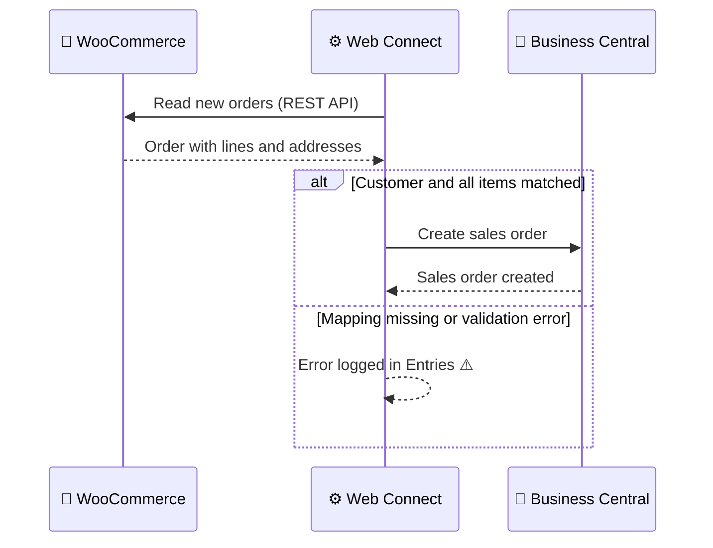

# WooCommerce to Business Central: order inbound

When a customer places an order in WooCommerce, Web Connect reads it through the WooCommerce REST API and creates a sales order in Business Central. [ATT FYLLA I: what starts the flow, schedule or webhook, verified in the configuration export.]

| | |
|---|---|
| **Direction** | WooCommerce → Business Central |
| **Trigger** | [ATT FYLLA I: schedule in the job queue or WooCommerce webhook] |
| **Result** | A sales order in Business Central. [ATT FYLLA I: whether anything is written back to the order in WooCommerce] |
| **Part of** | [Business Central and WooCommerce integration](../overview.md) |

## Step by step

1. The customer places an order in WooCommerce.
2. Web Connect reads the order from the WooCommerce REST API. [ATT FYLLA I: how new orders are found, for example by status or by date modified.]
3. Web Connect creates a sales order in Business Central with the order lines.
4. [ATT FYLLA I: whether the order status is updated in WooCommerce afterwards.]

## Data mapping

| WooCommerce field | Business Central field | Note |
|---|---|---|
| [ATT FYLLA I: order number] | [ATT FYLLA I] | [ATT FYLLA I] |
| [ATT FYLLA I: line SKU] | [ATT FYLLA I: item and variant] | [ATT FYLLA I] |
| [ATT FYLLA I: billing and shipping address] | [ATT FYLLA I: sell-to and ship-to] | [ATT FYLLA I] |
| [ATT FYLLA I: shipping lines] | [ATT FYLLA I] | [ATT FYLLA I] |

## Web Connect objects

| Object | Role |
|---|---|
| [ATT FYLLA I: `OBJECT_CODE`] | [ATT FYLLA I: objects for the order, its lines and addresses, from the configuration export] |

## Error handling

| Situation | What happens | What to do |
|---|---|---|
| WooCommerce API not reachable or credentials rejected | No orders are read | Check the stored credentials in [Secret Value Storage](../../../general/secret-value-storage.md) and see [Integrations not running](../../../../../how-to/web-connect/integration-not-running.md) |
| An item on the order is not found in Business Central | The error is logged in [Entries](../../../general/entries.md). [ATT FYLLA I: confirm that the sales order is not created] | [ATT FYLLA I: action] |
| [ATT FYLLA I: other errors] | [ATT FYLLA I] | [ATT FYLLA I] |

## Frequently asked questions

### [ATT FYLLA I: a real question about this flow]

[ATT FYLLA I: answer]

## Related

- [Business Central and WooCommerce integration](../overview.md)
- [WooCommerce REST API: orders](https://woocommerce.github.io/woocommerce-rest-api-docs/#orders)
- [Web Connect Entries](../../../general/entries.md)
