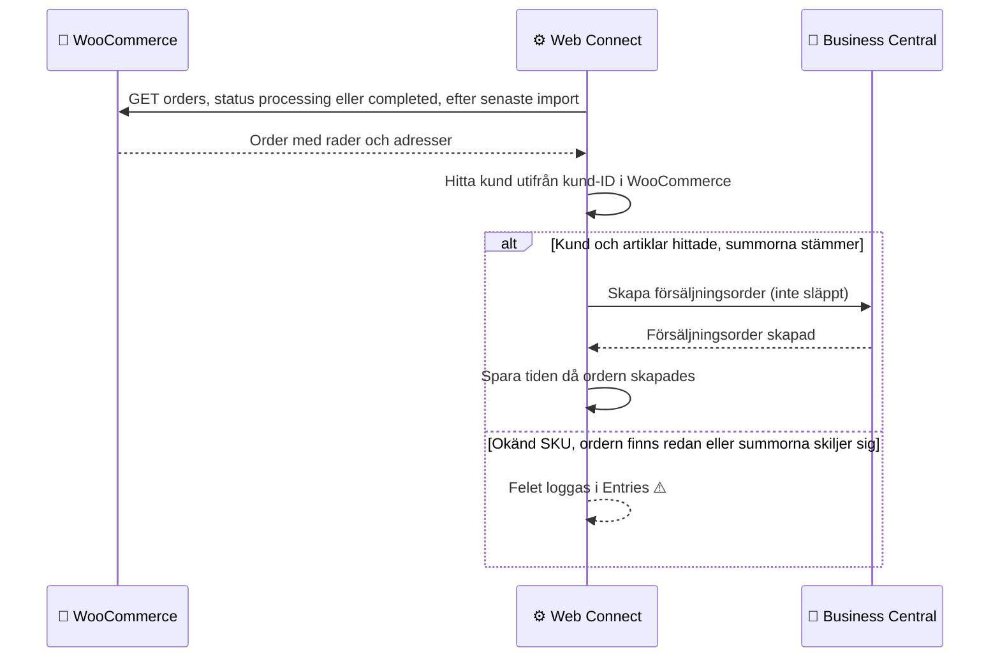

# Från WooCommerce till Business Central: order

Web Connect hämtar order med status processing eller completed från WooCommerce enligt schema och skapar en försäljningsorder i Business Central för var och en. Web Connect frågar bara efter order som skapats efter den senast importerade ordern och stämmer av orderns totalbelopp och moms mot WooCommerce.

| | |
|---|---|
| **Riktning** | WooCommerce → Business Central |
| **Startas av** | Schema i jobbkön i Business Central |
| **Resultat** | En försäljningsorder i Business Central som inte är släppt, med ordernumret från WooCommerce som ordernummer och externt dokumentnummer |
| **Del av** | [Business Central och WooCommerce: integration](../overview.md) |

## Steg för steg

1. Kunden lägger och betalar en order i WooCommerce.
2. Web Connect frågar WooCommerce efter order med status processing eller completed som skapats efter den senast importerade ordern. Web Connect läser 100 order åt gången, äldst först.
3. Kunden hittas utifrån kund-ID:t i WooCommerce, bland de kunder som hämtats i flödet [Kunder in](customer-inbound.md).
4. Web Connect skapar försäljningsordern med leveransadressen och en artikelrad per orderrad.
5. Orderns totalbelopp och momsbelopp stäms av mot WooCommerce.
6. Tiden då ordern skapades sparas, så att nästa körning börjar efter den.
7. Ordern lämnas osläppt, så att någon kan kontrollera den i Business Central.

## Mappning av data

| Fält i WooCommerce | Fält i Business Central | Kommentar |
|---|---|---|
| `number` | No. och External Document No. | Unikt. En order som redan finns ger ett fel |
| `id` | Externt ID i Web Connect | Används för att uppdatera ordern i WooCommerce senare |
| `customer_id` | Sell-to Customer No. | Slås upp bland de kunder som hämtats från WooCommerce |
| `date_created` | Document Date | Sparas också som startpunkt för nästa körning |
| `currency` | Currency Code | Den lokala valutan mappas till tomt |
| `shipping` namn, företag, adress, postnummer, ort, delstat, land, telefon | Fälten för Ship-to | |
| `line_items` `sku` | Item No. på försäljningsraden | Radtypen är Item |
| `line_items` `quantity` | Quantity | |
| `line_items` `price` | Unit Price | Priserna på ordern är exklusive moms |
| `total` och `total_tax` | Kontroll av summor | Jämförs med försäljningsordern |

Ett fast lagerställe kan sättas på ordern, och ett lagerställe per rad kan läsas från ett fält på artikeln.

## Objekt i Web Connect

| Objekt | Roll |
|---|---|
| `WOC-INC-ORDER` | Hämtar order och skapar försäljningshuvudet |
| `WOC-LINE_ITEMS` | Skapar försäljningsraderna |
| `WOC-SHIPPING` | Leveransadress på försäljningsordern |
| `WOC-WOOCOMMERCE-LAST-ORDER-URL` | Lägger till tiden för den senast importerade ordern i anropet |

## Felhantering

| Situation | Vad som händer | Vad du gör |
|---|---|---|
| SKU:n är ingen artikel i Business Central | Ordern skapas inte och felet loggas i [Entries](../../../general/entries.md) | Skapa artikeln eller rätta SKU:n i WooCommerce och behandla sedan den inkommande posten igen från Entries |
| Ordernumret finns redan | Ordern stoppas med ett fel | Kontrollera att ordern inte är en dubblett |
| Totalbelopp eller moms skiljer sig från WooCommerce | Ordern stannar i Incoming Data med ett felmeddelande, och ingen försäljningsorder skapas | Jämför ordern i båda systemen, rätta orsaken och behandla posten igen |
| WooCommerce går inte att nå eller inloggningsuppgifterna avvisas | Inga order hämtas. Nästa lyckade körning fortsätter från den senast importerade ordern | Kontrollera den sparade hemligheten och se [Integrationer som inte körs](../../../../../how-to/web-connect/integration-not-running.md) |

## Vanliga frågor

### Varför importerades inte en order från WooCommerce?

Bara order med status processing eller completed hämtas, så en order som väntar på betalning eller är pausad (on hold) kommer in först när den når processing. Har ordern redan den statusen, kontrollera felet i Web Connect Entries, till exempel en okänd SKU eller ett totalbelopp som inte stämmer.

## Relaterat

- [Business Central och WooCommerce: integration](../overview.md)
- [Kunder in](customer-inbound.md) · [Färdigställda order](order-completion.md)
- [WooCommerce REST API: order](https://woocommerce.github.io/woocommerce-rest-api-docs/#orders)
