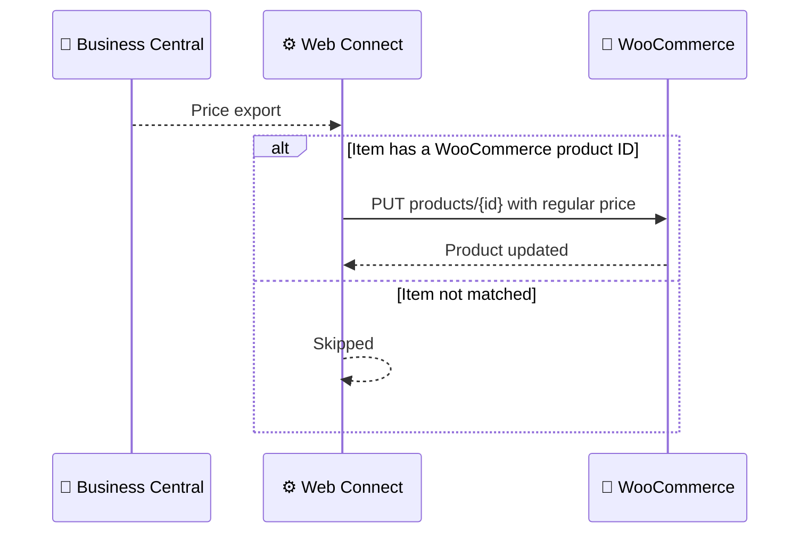

# Business Central to WooCommerce: price update

Web Connect sends the price from a chosen Business Central price list to WooCommerce as the regular price of the product. Only products that have been matched in WooCommerce are updated.

| | |
|---|---|
| **Direction** | Business Central → WooCommerce |
| **Trigger** | Web Connect price export. [ATT FYLLA I: when it runs, on a schedule or when a price changes] |
| **Result** | The regular price updated on the WooCommerce product |
| **Part of** | [Business Central and WooCommerce integration](../overview.md) |

## Step by step

1. A price changes on the chosen price list in Business Central.
2. Web Connect checks that the item has a WooCommerce product ID from [Product matching](product-matching.md).
3. The price is sent as the regular price to the product, once per language version.

## Data mapping

| Business Central field | WooCommerce field | Note |
|---|---|---|
| Unit Price on the chosen price list | `regular_price` | Read with a dynamic flow field, so the price list can be changed |
| Stored product ID | Product in the URL | From [Product matching](product-matching.md) |

## Web Connect objects

| Object | Role |
|---|---|
| `WOC-ITEMPRICE` | Sends the price to the product in the first language |
| `WOC-ITEMPRICE_ENG` | Sends the price to the product in the second language |

## Related

- [Business Central and WooCommerce integration](../overview.md)
- [Product matching](product-matching.md) · [Stock update](stock-update.md)
