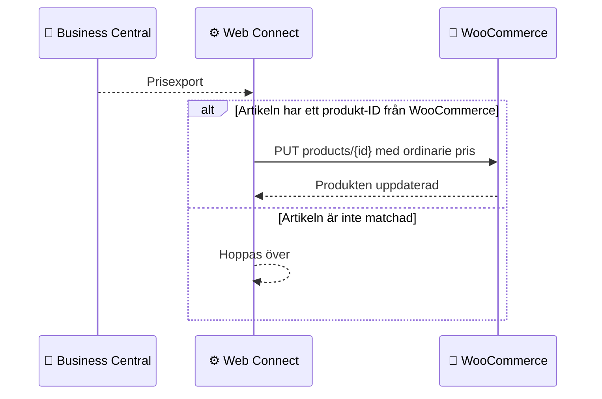

# Från Business Central till WooCommerce: priser

Web Connect skickar priset från en vald prislista i Business Central till WooCommerce som produktens ordinarie pris. Bara produkter som har matchats i WooCommerce uppdateras.

| | |
|---|---|
| **Riktning** | Business Central → WooCommerce |
| **Startas av** | Prisexporten i Web Connect i jobbkön i Business Central. Hur ofta jobbet körs kan anpassas efter vad ditt företag behöver |
| **Resultat** | Det ordinarie priset uppdaterat på produkten i WooCommerce |
| **Del av** | [Business Central och WooCommerce: integration](../overview.md) |

## Steg för steg

1. Ett pris ändras på den valda prislistan i Business Central.
2. Web Connect kontrollerar att artikeln har ett produkt-ID från WooCommerce via [Produktmatchning](product-matching.md).
3. Priset skickas som ordinarie pris till produkten, en gång per språkversion.

## Mappning av data

| Fält i Business Central | Fält i WooCommerce | Kommentar |
|---|---|---|
| Unit Price på den valda prislistan | `regular_price` | Läses med ett dynamiskt flödesfält, så att prislistan går att byta |
| Sparat produkt-ID | Produkten i URL:en | Från [Produktmatchning](product-matching.md) |

## Objekt i Web Connect

| Objekt | Roll |
|---|---|
| `WOC-ITEMPRICE` | Skickar priset till produkten på det första språket |
| `WOC-ITEMPRICE_ENG` | Skickar priset till produkten på det andra språket |

## Relaterat

- [Business Central och WooCommerce: integration](../overview.md)
- [Produktmatchning](product-matching.md) · [Lagersaldo](stock-update.md)
