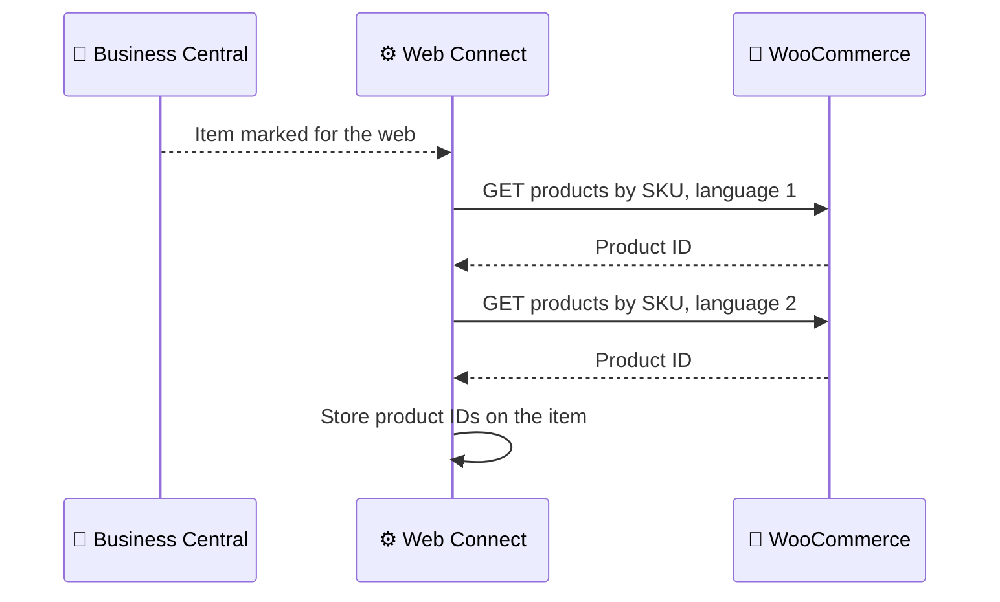

# Business Central to WooCommerce: product matching

Web Connect finds each Business Central item in WooCommerce by SKU and stores the WooCommerce product ID. In a multilingual store this is done once per language, so prices and stock reach every language version.

| | |
|---|---|
| **Direction** | Business Central → WooCommerce, with the answer back to Business Central |
| **Trigger** | A chosen field on the item changes, for example when the item is marked for the web shop, and on a schedule in the job queue |
| **Result** | The WooCommerce product ID per language stored in Web Connect for the item |
| **Part of** | [Business Central and WooCommerce integration](../overview.md) |

## Step by step

1. An item is marked for the web shop in Business Central.
2. Web Connect asks WooCommerce for the product with the item number as SKU, once for each language.
3. The product ID in the answer is stored as the external ID of the item for that language.
4. [Price update](price-update.md) and [Stock update](stock-update.md) use the stored ID.

## Data mapping

| Business Central field | WooCommerce field | Note |
|---|---|---|
| No. | `sku` | Search parameter, together with the language |
| External ID in Web Connect | `id` | Read from the answer |

## Web Connect objects

| Object | Role |
|---|---|
| `WOC-ITEM` | Finds the product in the first language |
| `WOC-ITEM_ENG` | Finds the product in the second language |

## Related

- [Business Central and WooCommerce integration](../overview.md)
- [Price update](price-update.md) · [Stock update](stock-update.md)
