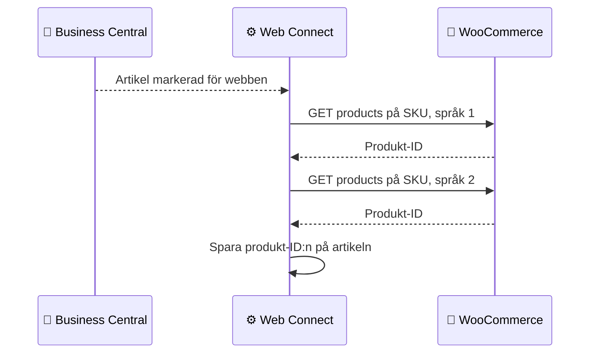

# Från Business Central till WooCommerce: produktmatchning

Web Connect hittar varje artikel från Business Central i WooCommerce på SKU och sparar produkt-ID:t från WooCommerce. I en butik med flera språk görs det en gång per språk, så att priser och lagersaldo når varje språkversion.

| | |
|---|---|
| **Riktning** | Business Central → WooCommerce, med svaret tillbaka till Business Central |
| **Startas av** | Ett valt fält på artikeln ändras, till exempel när artikeln markeras för webbshoppen, och enligt schema i jobbkön |
| **Resultat** | Produkt-ID:t från WooCommerce per språk sparat i Web Connect för artikeln |
| **Del av** | [Business Central och WooCommerce: integration](../overview.md) |

## Steg för steg

1. En artikel markeras för webbshoppen i Business Central.
2. Web Connect frågar WooCommerce efter produkten med artikelnumret som SKU, en gång för varje språk.
3. Produkt-ID:t i svaret sparas som artikelns externa ID för det språket.
4. Flödena [Prisuppdatering](price-update.md) och [Lagersaldo](stock-update.md) använder det sparade ID:t.

## Mappning av data

| Fält i Business Central | Fält i WooCommerce | Kommentar |
|---|---|---|
| No. | `sku` | Sökparameter, tillsammans med språket |
| Externt ID i Web Connect | `id` | Läses från svaret |

## Objekt i Web Connect

| Objekt | Roll |
|---|---|
| `WOC-ITEM` | Hittar produkten på det första språket |
| `WOC-ITEM_ENG` | Hittar produkten på det andra språket |

## Relaterat

- [Business Central och WooCommerce: integration](../overview.md)
- [Prisuppdatering](price-update.md) · [Lagersaldo](stock-update.md)
