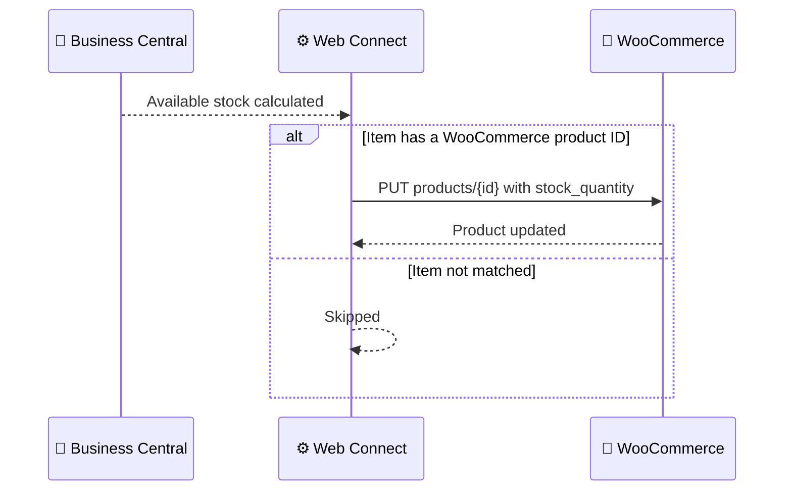

# Business Central to WooCommerce: stock update

Web Connect calculates available stock in Business Central and sends it to WooCommerce as the stock quantity of the product. Only products that have been matched in WooCommerce are updated.

| | |
|---|---|
| **Direction** | Business Central → WooCommerce |
| **Trigger** | Web Connect [Item Inventory](../../../general/item-inventory.md) in the Business Central job queue. How often the job runs can be adjusted to what your business needs |
| **Result** | The stock quantity updated on the WooCommerce product |
| **Part of** | [Business Central and WooCommerce integration](../overview.md) |

## Step by step

1. Web Connect calculates available stock for the item in Item Inventory.
2. Web Connect checks that the item has a WooCommerce product ID from [Product matching](product-matching.md).
3. The stock is sent as the stock quantity of the product.

## Data mapping

| Business Central field | WooCommerce field | Note |
|---|---|---|
| Available stock in Item Inventory | `stock_quantity` | |
| Stored product ID | Product in the URL | From [Product matching](product-matching.md) |

## Web Connect objects

| Object | Role |
|---|---|
| `WOC-ITEMINVENTORY_ENG` | Sends stock to the product |

## Related

- [Business Central and WooCommerce integration](../overview.md)
- [Product matching](product-matching.md) · [Price update](price-update.md)
