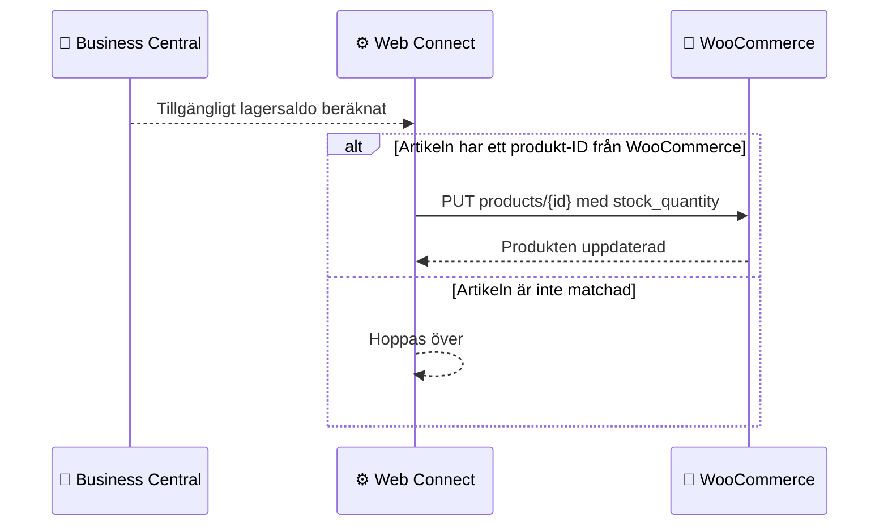

# Från Business Central till WooCommerce: lagersaldo

Web Connect beräknar tillgängligt lagersaldo i Business Central och skickar det till WooCommerce som produktens lagerantal. Bara produkter som har matchats i WooCommerce uppdateras.

| | |
|---|---|
| **Riktning** | Business Central → WooCommerce |
| **Startas av** | Web Connect [Item Inventory](../../../general/item-inventory.md) i jobbkön i Business Central. Hur ofta jobbet körs kan anpassas efter vad ditt företag behöver |
| **Resultat** | Lagerantalet uppdaterat på produkten i WooCommerce |
| **Del av** | [Business Central och WooCommerce: integration](../overview.md) |

## Steg för steg

1. Web Connect beräknar tillgängligt lagersaldo för artikeln i Item Inventory.
2. Web Connect kontrollerar att artikeln har ett produkt-ID från WooCommerce via [Produktmatchning](product-matching.md).
3. Lagersaldot skickas som produktens lagerantal.

## Mappning av data

| Fält i Business Central | Fält i WooCommerce | Kommentar |
|---|---|---|
| Tillgängligt lagersaldo i Item Inventory | `stock_quantity` | |
| Sparat produkt-ID | Produkten i URL:en | Från [Produktmatchning](product-matching.md) |

## Objekt i Web Connect

| Objekt | Roll |
|---|---|
| `WOC-ITEMINVENTORY_ENG` | Skickar lagersaldot till produkten |

## Relaterat

- [Business Central och WooCommerce: integration](../overview.md)
- [Produktmatchning](product-matching.md) · [Prisuppdatering](price-update.md)
