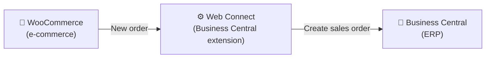
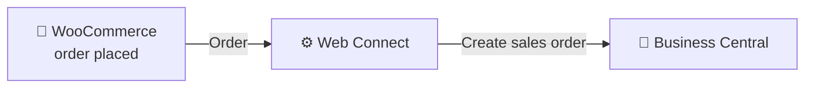

# Business Central and WooCommerce integration

Web Connect by CombineIT connects Microsoft Dynamics 365 Business Central with WooCommerce, the e-commerce platform for WordPress. Orders from the WooCommerce store are created as sales orders in Business Central. All mappings and rules live in your own Business Central, where you can see and change them yourself.

## At a glance

| | |
|---|---|
| **System** | WooCommerce (e-commerce for WordPress) |
| **Integration product** | Web Connect for Microsoft Dynamics 365 Business Central |
| **Runs in** | Your own Business Central environment, as an extension. [ATT FYLLA I: how orders come in, verified in the configuration export: fetched on a schedule from the job queue, or received from a WooCommerce webhook through the Azure endpoint.] All processing and configuration stays in Business Central. |
| **Configured by** | You, in Business Central: mappings, conditions, triggers and flows. You can do all of it yourself. If you want, CombineIT takes part in any step, as a sounding board or by doing the work. |
| **Connection** | WooCommerce REST API (version 3, JSON) with basic authentication |
| **WooCommerce API** | [WooCommerce REST API documentation](https://woocommerce.github.io/woocommerce-rest-api-docs/) |
| **Data flows** | 1: orders |
| **Business Central editions** | [ATT FYLLA I: Essentials, Premium] |
| **Available from** | [Web Connect on Microsoft AppSource](https://marketplace.microsoft.com/sv-se/product/PUBID.martitab1633951001710%7CAID.webconnect%7CPAPPID.9f3a7223-19db-4ac7-832f-cf8e4699186f?tab=Overview). [ATT FYLLA I: is WooCommerce included in the Web Connect Ready Integrations app?] |

## What can be synchronized

Web Connect has one verified data flow between Business Central and WooCommerce.

| Data | Direction | What happens |
|---|---|---|
| [Orders](flows/order-inbound.md) | WooCommerce → Business Central | A sales order is created in Business Central for each new order in WooCommerce |
| [ATT FYLLA I: shipments, order status, stock, products or prices, if any of them are sent back to WooCommerce] | Business Central → WooCommerce | [ATT FYLLA I] |

Orders are part of every WooCommerce integration. [ATT FYLLA I: which other flows can be chosen at setup.] See [Choose your setup](#choose-your-setup).

## How it works

Web Connect reads orders from WooCommerce through the WooCommerce REST API and creates them as sales orders in Business Central. [ATT FYLLA I: what starts the flow (schedule or webhook) and how errors are handled, verified in the configuration export.] Every message is logged in Web Connect Entries, where it can be inspected and resent.

## Choose your setup

Each flow has to fit how your business works: which system owns the data, where people do their work, and what the accounting needs. That is why the flows are decided together when a new integration is set up. The options below are the ones in use with Web Connect customers on WooCommerce today. One Web Connect customer uses WooCommerce, so no option is marked as common setup.

### Orders

| Option | How it works | When it fits |
|---|---|---|
| **WooCommerce → Business Central** | Orders are read from WooCommerce and created as sales orders in Business Central | Always. This is the core of the integration |

#### Orders from WooCommerce to Business Central

[ATT FYLLA I: one subsection per further data area (shipments, stock, products, prices) that is in use, with its own process flow. Only options verified in a configuration export.]

[ATT FYLLA I: what is always maintained in WooCommerce, for example product texts, images and categories.]

## What you need

- Microsoft Dynamics 365 Business Central [ATT FYLLA I: edition and version]
- Web Connect installed from Microsoft AppSource, with an activated Web Connect license
- Your approval for Web Connect to be installed and to act in your Business Central environment
- REST API access to your WooCommerce store, with credentials for basic authentication stored in Web Connect [Secret Value Storage](../../general/secret-value-storage.md). [ATT FYLLA I: where the keys are created in WooCommerce and which permissions they need]
- [ATT FYLLA I: anything else that is required in WooCommerce, verified in the configuration export]

## Setting it up

1. Decide which flows to use and which option to choose for each, see [Choose your setup](#choose-your-setup).
2. Install Web Connect in Business Central, activate the license and give your approval. [ATT FYLLA I: install the ready integration for WooCommerce, if there is one.]
3. Create REST API keys in WooCommerce and store them in Web Connect [Secret Value Storage](../../general/secret-value-storage.md).
4. Set up the configuration choices below.
5. Test the order flow in a Business Central sandbox against a WooCommerce test store before going live.

## Configure it yourself in Business Central

All configuration and logic in the integration is visible and editable in Business Central. There is no external integration platform where the logic is hidden. [ATT FYLLA I: only if the integration uses incoming webhooks: the Azure endpoint that receives webhooks only passes the call on to Web Connect.]

| What you can change | Where in Web Connect | Example |
|---|---|---|
| Field mapping on orders | [Incoming Data mapping](../../general/incoming-data/mapping.md) | Map a WooCommerce order field to a field on the sales order |
| Conditions | [Condition List](../../general/condition-list.md) | [ATT FYLLA I: a condition used on WooCommerce orders] |
| Value mapping | [Text Mapping](../../general/text-mapping.md) | [ATT FYLLA I: for example payment method or shipping method to a Business Central code] |
| Monitoring and resending | [Entries](../../general/entries.md) | See every order that came in, and [resend a message](../../../../how-to/web-connect/resend-outgoing-message.md) |

## Configuration choices

- **Customer on the order:** [ATT FYLLA I: whether each order gets its own customer, is matched on email, or uses one web shop customer.]
- **Item matching:** [ATT FYLLA I: how WooCommerce products and variations are matched to Business Central items and variants, for example by SKU.]
- **Shipping fees:** [ATT FYLLA I: how the shipping cost on WooCommerce orders is posted in Business Central.]
- **Orders to import:** [ATT FYLLA I: which WooCommerce order statuses are imported.]

## Limitations

- **Only orders are verified.** The documented flow brings orders from WooCommerce into Business Central. [ATT FYLLA I: whether shipments, stock, products or prices can be sent to WooCommerce.]
- [ATT FYLLA I: known behaviour that surprises users.]

## Frequently asked questions

### Can Business Central be integrated with WooCommerce?

Yes. Web Connect connects Business Central with WooCommerce through the WooCommerce REST API. Orders from the WooCommerce store are created as sales orders in Business Central.

### Can we change what is sent between Business Central and WooCommerce ourselves?

Yes. Field mappings, conditions, triggers and which flows are active are configured in Web Connect inside your own Business Central. You can see and change them without asking a supplier to change an external platform.

### [ATT FYLLA I: a real question from support or a customer meeting about WooCommerce]

[ATT FYLLA I: answer]

## Related

- Flows: [Order inbound](flows/order-inbound.md)
- How-to: [Resend an outgoing message](../../../../how-to/web-connect/resend-outgoing-message.md) · [Integrations not running](../../../../how-to/web-connect/integration-not-running.md)
- [Web Connect general documentation](../../general/README.md)
- [WooCommerce REST API documentation](https://woocommerce.github.io/woocommerce-rest-api-docs/)

## About Web Connect

Web Connect is an integration platform for Microsoft Dynamics 365 Business Central, developed by CombineIT. It is installed in your own Business Central and connects it with e-commerce platforms, warehouse systems, POS, returns, marketplaces and EDI. Every flow, mapping and rule is configured in Business Central, where you can see and change it yourself, without custom code for each integration. [Web Connect on Microsoft AppSource](https://marketplace.microsoft.com/sv-se/product/PUBID.martitab1633951001710%7CAID.webconnect%7CPAPPID.9f3a7223-19db-4ac7-832f-cf8e4699186f?tab=Overview) · [Contact CombineIT](https://www.combineit.se/contact/)
