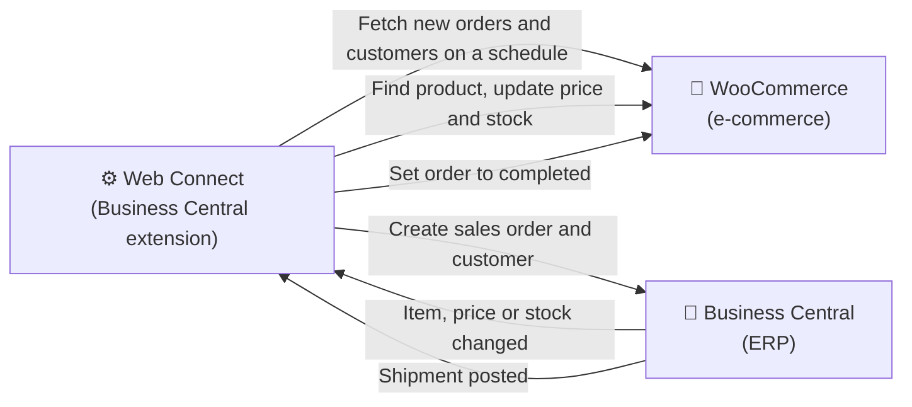
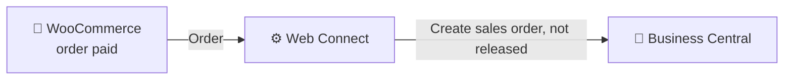
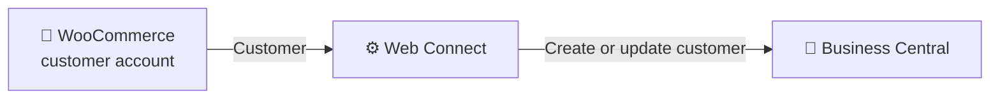
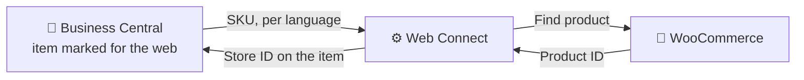
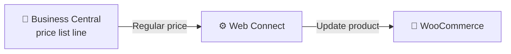
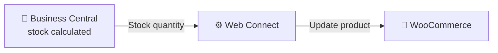
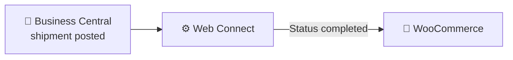

# Business Central and WooCommerce integration

Web Connect by CombineIT connects Microsoft Dynamics 365 Business Central with WooCommerce, the e-commerce platform for WordPress. Orders and customers are fetched from WooCommerce into Business Central, and prices, stock and order completion are sent back to WooCommerce. All mappings and rules live in your own Business Central, where you can see and change them yourself.

## At a glance

| | |
|---|---|
| **System** | WooCommerce (e-commerce for WordPress) |
| **Integration product** | Web Connect for Microsoft Dynamics 365 Business Central |
| **Runs in** | Your own Business Central environment, as an extension. Web Connect fetches new orders and customers from WooCommerce on a schedule in the Business Central job queue and sends updates to WooCommerce from Business Central. No webhooks and no external integration platform are involved. |
| **Configured by** | You, in Business Central: mappings, conditions, triggers and flows. You can do all of it yourself. If you want, CombineIT takes part in any step, as a sounding board or by doing the work. |
| **Connection** | WooCommerce REST API (version 3, JSON) with basic authentication |
| **WooCommerce API** | [WooCommerce REST API documentation](https://woocommerce.github.io/woocommerce-rest-api-docs/) |
| **Data flows** | 6: orders, customers, product matching, prices, stock and order completion |
| **Business Central editions** | [ATT FYLLA I: Essentials, Premium] |
| **Available from** | [Web Connect on Microsoft AppSource](https://marketplace.microsoft.com/sv-se/product/PUBID.martitab1633951001710%7CAID.webconnect%7CPAPPID.9f3a7223-19db-4ac7-832f-cf8e4699186f?tab=Overview). [ATT FYLLA I: is WooCommerce included in the Web Connect Ready Integrations app?] |

## What can be synchronized

Web Connect has six data flows between Business Central and WooCommerce.

| Data | Direction | What happens |
|---|---|---|
| [Orders](flows/order-inbound.md) | WooCommerce → Business Central | Paid and completed orders are fetched, and a sales order is created with lines and delivery address |
| [Customers](flows/customer-inbound.md) | WooCommerce → Business Central | WooCommerce customers are created or updated as customers in Business Central |
| [Product matching](flows/product-matching.md) | Business Central → WooCommerce | Each item is looked up in WooCommerce by SKU, and the WooCommerce product ID is stored in Business Central |
| [Prices](flows/price-update.md) | Business Central → WooCommerce | The regular price from a Business Central price list is set on the product |
| [Stock](flows/stock-update.md) | Business Central → WooCommerce | Available stock is set on the product |
| [Order completion](flows/order-completion.md) | Business Central → WooCommerce | When the shipment is posted, the order is set to completed in WooCommerce |

Orders are part of every WooCommerce integration. Product matching is needed for prices and stock, since they are sent to the WooCommerce product ID. See [Choose your setup](#choose-your-setup).

## How it works

Web Connect asks the WooCommerce REST API for orders created after the last imported order, 100 at a time and oldest first. It remembers the creation time of the last order it imported and starts from there on the next run. For each order it finds the customer, creates the sales order with lines and delivery address, and checks the order total and VAT against WooCommerce. When something changes in Business Central (an item is marked for the web, a price or the stock changes, a shipment is posted), Web Connect sends the change to WooCommerce. Every message in both directions is logged in Web Connect Entries, where it can be inspected and resent.

## Choose your setup

Each flow has to fit how your business works: which system owns the data, where people do their work, and what the accounting needs. That is why the flows are decided together when a new integration is set up. The options below are the ones that have been used in production with Web Connect and WooCommerce. One Web Connect customer has run WooCommerce, so no option is marked as common setup.

### Orders

| Option | How it works | When it fits |
|---|---|---|
| **WooCommerce → Business Central, released manually** | Orders with status processing or completed are fetched and created as sales orders. They are not released automatically, so someone checks them in Business Central first | Always. This is the core of the integration |

#### Orders from WooCommerce to Business Central

### Customers

| Option | How it works | When it fits |
|---|---|---|
| **Fetched from WooCommerce** | Customers registered in WooCommerce are created or updated in Business Central. The WooCommerce customer ID is stored, so each order can find its customer | Customers register accounts in the web shop |

#### Customers fetched from WooCommerce

### Products

| Option | How it works | When it fits |
|---|---|---|
| **Created in WooCommerce, matched by SKU** | Products are created and enriched in WooCommerce. Business Central looks up each item by SKU and stores the product ID, once per language | The web team owns the products, and Business Central owns price and stock |

#### Products created in WooCommerce and matched by SKU

### Prices

| Option | How it works | When it fits |
|---|---|---|
| **Business Central → WooCommerce** | The price on a chosen Business Central price list is sent as the regular price of the product, for every language version | Prices are decided in Business Central |

#### Prices from Business Central to WooCommerce

### Stock

| Option | How it works | When it fits |
|---|---|---|
| **Calculated in Business Central** | Available stock is calculated in Business Central and set as the stock quantity of the product | Business Central has the correct stock |

#### Stock calculated in Business Central

### Order completion

| Option | How it works | When it fits |
|---|---|---|
| **Completed when shipped** | When a shipment for a WooCommerce order is posted, the order is set to completed in WooCommerce | The warehouse work is registered in Business Central, directly or through a warehouse integration |

#### Order completed when shipped

Product creation, texts, images, categories and translations are always maintained in WooCommerce.

## What you need

- Microsoft Dynamics 365 Business Central [ATT FYLLA I: edition and version]
- Web Connect installed from Microsoft AppSource, with an activated Web Connect license
- Your approval for Web Connect to be installed and to act in your Business Central environment
- WooCommerce REST API keys (consumer key and consumer secret), with read and write access to orders, customers and products. The secret is stored in Web Connect [Secret Value Storage](../../general/secret-value-storage.md)
- A SKU on every WooCommerce product, the same as the item number in Business Central

## Setting it up

1. Decide which flows to use and which option to choose for each, see [Choose your setup](#choose-your-setup).
2. Install Web Connect in Business Central, activate the license and give your approval. [ATT FYLLA I: install the ready integration for WooCommerce, if there is one.]
3. Create REST API keys in WooCommerce under WooCommerce, Settings, Advanced, REST API, and store the secret in Web Connect [Secret Value Storage](../../general/secret-value-storage.md).
4. Set the date and time from which orders should be fetched, so old orders are not imported.
5. Set up the configuration choices below.
6. Test the order flow in a Business Central sandbox against a WooCommerce test store before going live.

## Configure it yourself in Business Central

All configuration and logic in the integration is visible and editable in Business Central. There is no external integration platform where the logic is hidden.

| What you can change | Where in Web Connect | Example |
|---|---|---|
| Field mapping on orders | [Incoming Data mapping](../../general/incoming-data/mapping.md) | Map a WooCommerce order field to a field on the sales order, or set a fixed location |
| Automatic release | [Condition List](../../general/condition-list.md) | Decide whether WooCommerce orders are released automatically or checked first |
| Currency | [Text Mapping](../../general/text-mapping.md) | Map the store currency to the local currency in Business Central |
| Which items are sent | [Outgoing Sync Triggers](../../general/outgoing-mapping/outgoing-sync-triggers.md) | Look up an item in WooCommerce when a field on the item changes |
| Which price is sent | [Dynamic Flow Fields](../../general/dynamic-flow-fields.md) | Choose which Business Central price list gives the regular price |
| Monitoring and resending | [Entries](../../general/entries.md) | See every order and update, and [resend a message](../../../../how-to/web-connect/resend-outgoing-message.md) |

## Configuration choices

- **Order statuses to import:** which WooCommerce statuses are fetched. Processing and completed are used, so unpaid orders are not imported.
- **Starting point:** the date and time from which orders are fetched. Web Connect moves it forward after each imported order.
- **Customer on the order:** the WooCommerce customer ID is looked up among the customers fetched from WooCommerce.
- **Customer number:** which Business Central customer number a WooCommerce customer gets. It can be read from a meta data field on the WooCommerce customer.
- **Item matching:** the SKU on the WooCommerce order line is the item number in Business Central.
- **Location:** a fixed location on the order, or a location per line from a field on the item.
- **Release:** whether orders are released automatically.
- **Price list:** which Business Central price list gives the regular price in WooCommerce.
- **Languages:** one product lookup per language version of the store.

## Limitations

- **Products are not created in WooCommerce.** Web Connect only finds existing products by SKU. Products, texts, images and categories are created in WooCommerce.
- **Only the regular price is sent.** Sale prices and scheduled prices are set in WooCommerce. [ATT FYLLA I: confirm]
- **No tracking number is sent.** Order completion only sets the status to completed.
- **Coupons, fees and refunds are not mapped** on incoming orders. [ATT FYLLA I: how discounts and shipping cost reach the sales order, and how the totals check handles them]
- **Unpaid orders are not imported.** Orders on hold or pending payment are fetched only once they reach processing.
- **Products without a SKU cannot be matched** to an item in Business Central.

## Frequently asked questions

### Can Business Central be integrated with WooCommerce?

Yes. Web Connect connects Business Central with WooCommerce through the WooCommerce REST API. Orders and customers are fetched into Business Central, and prices, stock and order completion are sent to WooCommerce.

### Does the integration work with a multilingual WooCommerce store?

Yes. Web Connect looks up each item in WooCommerce by SKU once per language and stores the product ID for each language version, so prices and stock can be sent to the right product.

### Are WooCommerce orders imported twice if the job runs again?

No. Web Connect only asks for orders created after the last imported order, and the WooCommerce order number is a unique key on the sales order. An order that already exists is stopped with an error instead of being created again.

### Can we change what is sent between Business Central and WooCommerce ourselves?

Yes. Field mappings, conditions, triggers and which flows are active are configured in Web Connect inside your own Business Central. You can see and change them without asking a supplier to change an external platform.

## Related

- Flows: [Order inbound](flows/order-inbound.md) · [Customer inbound](flows/customer-inbound.md) · [Product matching](flows/product-matching.md) · [Price update](flows/price-update.md) · [Stock update](flows/stock-update.md) · [Order completion](flows/order-completion.md)
- How-to: [Resend an outgoing message](../../../../how-to/web-connect/resend-outgoing-message.md) · [Integrations not running](../../../../how-to/web-connect/integration-not-running.md)
- [Web Connect general documentation](../../general/README.md)
- [WooCommerce REST API documentation](https://woocommerce.github.io/woocommerce-rest-api-docs/)

## About Web Connect

Web Connect is an integration platform for Microsoft Dynamics 365 Business Central, developed by CombineIT. It is installed in your own Business Central and connects it with e-commerce platforms, warehouse systems, POS, returns, marketplaces and EDI. Every flow, mapping and rule is configured in Business Central, where you can see and change it yourself, without custom code for each integration. [Web Connect on Microsoft AppSource](https://marketplace.microsoft.com/sv-se/product/PUBID.martitab1633951001710%7CAID.webconnect%7CPAPPID.9f3a7223-19db-4ac7-832f-cf8e4699186f?tab=Overview) · [Contact CombineIT](https://www.combineit.se/contact/)
