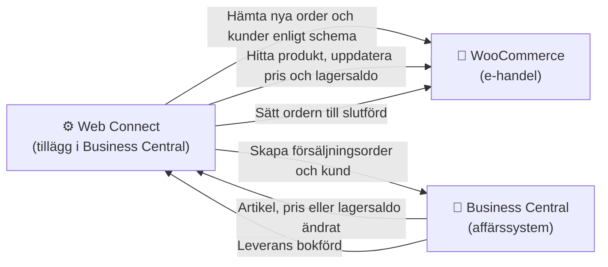
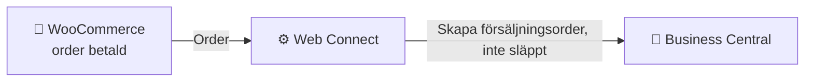
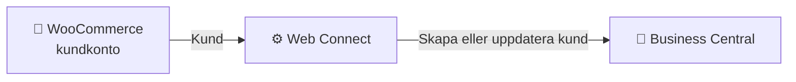
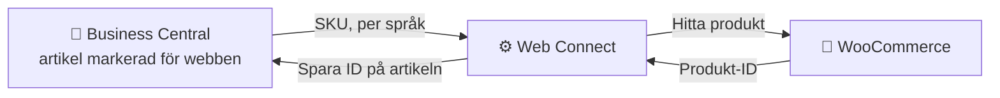
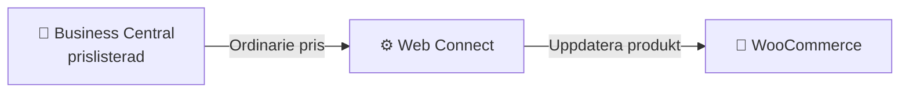
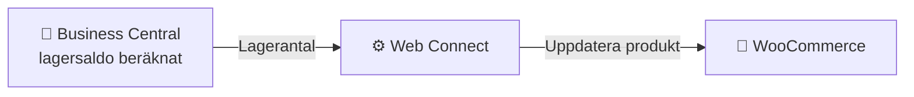
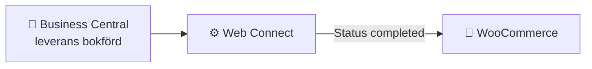

# Business Central och WooCommerce: integration

Web Connect från CombineIT kopplar ihop Microsoft Dynamics 365 Business Central med WooCommerce, e-handelsplattformen för WordPress. Order och kunder hämtas från WooCommerce till Business Central, och priser, lagersaldo och färdigställda order skickas tillbaka till WooCommerce. Alla mappningar och regler finns i ditt eget Business Central, där du själv kan se och ändra dem.

## I korthet

| | |
|---|---|
| **System** | WooCommerce (e-handel för WordPress) |
| **Integrationsprodukt** | Web Connect för Microsoft Dynamics 365 Business Central |
| **Körs i** | Din egen Business Central-miljö, som ett tillägg. Web Connect hämtar nya order och kunder från WooCommerce enligt schema i jobbkön i Business Central och skickar uppdateringar till WooCommerce från Business Central. Inga webhooks och ingen extern integrationsplattform är inblandade. |
| **Konfigureras av** | Dig, i Business Central: mappningar, villkor, triggers och flöden. Du kan göra allt själv. Om du vill är CombineIT med i vilket steg som helst, som bollplank eller genom att göra jobbet. |
| **Koppling** | WooCommerce REST API (version 3, JSON) med basic authentication |
| **WooCommerce API** | [Dokumentation för WooCommerce REST API](https://woocommerce.github.io/woocommerce-rest-api-docs/) |
| **Dataflöden** | 6: order, kunder, produktmatchning, priser, lagersaldo och färdigställda order |
| **Business Central-utgåvor** | Alla utgåvor, Essentials och Premium, även den senaste versionen |
| **Finns på** | [Web Connect på Microsoft AppSource](https://marketplace.microsoft.com/sv-se/product/PUBID.martitab1633951001710%7CAID.webconnect%7CPAPPID.9f3a7223-19db-4ac7-832f-cf8e4699186f?tab=Overview). Integrationen med WooCommerce sätts upp som en konfiguration i Web Connect. Den ingår inte i appen Web Connect Ready Integrations |

## Det här kan synkas

Web Connect har sex dataflöden mellan Business Central och WooCommerce.

| Data | Riktning | Vad som händer |
|---|---|---|
| [Order](flows/order-inbound.md) | WooCommerce → Business Central | Betalda och slutförda order hämtas, och en försäljningsorder skapas med rader och leveransadress |
| [Kunder](flows/customer-inbound.md) | WooCommerce → Business Central | Kunder i WooCommerce skapas eller uppdateras som kunder i Business Central |
| [Produktmatchning](flows/product-matching.md) | Business Central → WooCommerce | Varje artikel slås upp i WooCommerce på SKU, och produkt-ID:t från WooCommerce sparas i Business Central |
| [Priser](flows/price-update.md) | Business Central → WooCommerce | Ordinarie pris från en prislista i Business Central sätts på produkten |
| [Lagersaldo](flows/stock-update.md) | Business Central → WooCommerce | Tillgängligt lagersaldo sätts på produkten |
| [Färdigställda order](flows/order-completion.md) | Business Central → WooCommerce | När leveransen bokförs sätts ordern till slutförd (completed) i WooCommerce |

De sex flödena är de som har använts i produktion. Web Connect arbetar mot WooCommerce REST API, så annan data som API:et stöder, till exempel att skapa produkter, kampanjpriser, spårningsnummer eller återbetalningar, kan läggas till med konfiguration. Vad som skickas, och när, bestäms per integration.

Order ingår i alla integrationer med WooCommerce. Produktmatchningen behövs för priser och lagersaldo, eftersom de skickas till produkt-ID:t i WooCommerce. Se [Välj upplägg](#choose-your-setup).

## Så fungerar det

Web Connect frågar WooCommerce REST API efter order som skapats efter den senast importerade ordern, 100 åt gången och äldst först. Web Connect kommer ihåg när den senast importerade ordern skapades och börjar där nästa gång. För varje order letar Web Connect upp kunden, skapar försäljningsordern med rader och leveransadress och stämmer av orderns totalbelopp och moms mot WooCommerce. När något ändras i Business Central (en artikel markeras för webben, ett pris eller lagersaldot ändras, en leverans bokförs) skickar Web Connect ändringen till WooCommerce. Varje meddelande i båda riktningarna loggas i Web Connect Entries, där det går att granska och skicka om.

## Välj upplägg

Varje flöde måste passa hur ditt företag arbetar: vilket system som äger datan, var personalen gör sitt arbete och vad bokföringen behöver. Därför bestäms flödena tillsammans när en ny integration sätts upp. Alternativen nedan är de som har använts i produktion med Web Connect och WooCommerce. En Web Connect-kund har kört WooCommerce, så inget alternativ är markerat som vanligt upplägg.

### Order

| Alternativ | Så fungerar det | När det passar |
|---|---|---|
| **WooCommerce → Business Central, släpps manuellt** | Order med status processing eller completed hämtas och skapas som försäljningsorder. De släpps inte automatiskt, så att någon först kan kontrollera dem i Business Central | Alltid. Det här är kärnan i integrationen |

#### Order från WooCommerce till Business Central

### Kunder

| Alternativ | Så fungerar det | När det passar |
|---|---|---|
| **Hämtas från WooCommerce** | Kunder som registrerat sig i WooCommerce skapas eller uppdateras i Business Central. Kund-ID:t från WooCommerce sparas, så att varje order hittar sin kund | Kunderna skapar konton i webbshoppen |

#### Kunder som hämtas från WooCommerce

### Produkter

| Alternativ | Så fungerar det | När det passar |
|---|---|---|
| **Skapas i WooCommerce, matchas på SKU** | Produkter skapas och berikas i WooCommerce. Business Central slår upp varje artikel på SKU och sparar produkt-ID:t, en gång per språk | Webbteamet äger produkterna, och Business Central äger pris och lagersaldo |

#### Produkter som skapas i WooCommerce och matchas på SKU

### Priser

| Alternativ | Så fungerar det | När det passar |
|---|---|---|
| **Business Central → WooCommerce** | Priset på en vald prislista i Business Central skickas som produktens ordinarie pris, för varje språkversion | Priserna bestäms i Business Central |

#### Priser från Business Central till WooCommerce

### Lagersaldo

| Alternativ | Så fungerar det | När det passar |
|---|---|---|
| **Beräknas i Business Central** | Tillgängligt lagersaldo beräknas i Business Central och sätts som produktens lagerantal | Business Central har rätt lagersaldo |

#### Lagersaldo beräknat i Business Central

### Färdigställda order

| Alternativ | Så fungerar det | När det passar |
|---|---|---|
| **Slutförd när den skickats** | När en leverans för en order från WooCommerce bokförs sätts ordern till slutförd (completed) i WooCommerce | Lagerarbetet registreras i Business Central, direkt eller via en lagerintegration |

#### Ordern slutförs när den skickats

Att skapa produkter, texter, bilder, kategorier och översättningar sköts alltid i WooCommerce.

## Det här behöver du

- Microsoft Dynamics 365 Business Central, valfri utgåva (Essentials eller Premium), även den senaste versionen
- Web Connect installerat från Microsoft AppSource, med en aktiverad licens för Web Connect
- Ditt godkännande av att Web Connect installeras och agerar i din Business Central-miljö
- API-nycklar för WooCommerce REST API (consumer key och consumer secret), med läs- och skrivbehörighet till order, kunder och produkter. Hemligheten sparas i Web Connect [Secret Value Storage](../../general/secret-value-storage.md)
- En SKU på varje produkt i WooCommerce, samma som artikelnumret i Business Central

## Så kommer du igång

1. Bestäm vilka flöden ni ska använda och vilket alternativ ni väljer för vart och ett, se [Välj upplägg](#choose-your-setup).
2. Installera Web Connect i Business Central, aktivera licensen och ge ditt godkännande. Sätt upp konfigurationen för WooCommerce i Web Connect.
3. Skapa API-nycklar i WooCommerce under WooCommerce, Settings, Advanced, REST API, och spara hemligheten i Web Connect [Secret Value Storage](../../general/secret-value-storage.md).
4. Ange datum och tid som order ska hämtas från, så att gamla order inte importeras.
5. Gör valen i konfigurationen nedan.
6. Testa orderflödet i en sandlåda i Business Central mot en testbutik i WooCommerce innan ni går live.

## Konfigurera själv i Business Central

All konfiguration och logik i integrationen syns och går att ändra i Business Central. Det finns ingen extern integrationsplattform där logiken är dold.

| Det här kan du ändra | Var i Web Connect | Exempel |
|---|---|---|
| Fältmappning på order | [Incoming Data mapping](../../general/incoming-data/mapping.md) | Mappa ett orderfält i WooCommerce till ett fält på försäljningsordern, eller sätt ett fast lagerställe |
| Automatisk släppning | [Condition List](../../general/condition-list.md) | Bestäm om order från WooCommerce ska släppas automatiskt eller kontrolleras först |
| Valuta | [Text Mapping](../../general/text-mapping.md) | Mappa butikens valuta till den lokala valutan i Business Central |
| Vilka artiklar som skickas | [Outgoing Sync Triggers](../../general/outgoing-mapping/outgoing-sync-triggers.md) | Slå upp en artikel i WooCommerce när ett fält på artikeln ändras |
| Vilket pris som skickas | [Dynamic Flow Fields](../../general/dynamic-flow-fields.md) | Välj vilken prislista i Business Central som ger det ordinarie priset |
| Övervakning och omsändning | [Entries](../../general/entries.md) | Se varje order och uppdatering, och [skicka om ett meddelande](../../../../how-to/web-connect/resend-outgoing-message.md) |

## Val i konfigurationen

- **Orderstatusar som importeras:** vilka statusar i WooCommerce som hämtas. Processing och completed används, så att obetalda order inte importeras.
- **Rabatter, kuponger och fraktkostnad:** hur de bokas på försäljningsordern.
- **Startpunkt:** datum och tid som order hämtas från. Web Connect flyttar fram den efter varje importerad order.
- **Kund på ordern:** kund-ID:t från WooCommerce slås upp bland de kunder som hämtats från WooCommerce.
- **Kundnummer:** vilket kundnummer i Business Central en kund från WooCommerce får. Det kan läsas från ett metadatafält på kunden i WooCommerce.
- **Matchning av artiklar:** SKU:n på orderraden i WooCommerce är artikelnumret i Business Central.
- **Lagerställe:** ett fast lagerställe på ordern, eller ett lagerställe per rad från ett fält på artikeln.
- **Släppning:** om order släpps automatiskt.
- **Prislista:** vilken prislista i Business Central som ger det ordinarie priset i WooCommerce.
- **Språk:** en butik med flera språkversioner får en produktuppslagning per språk.

## Begränsningar

- **Summorna måste stämma.** Om orderns totalbelopp eller momsbelopp skiljer sig från WooCommerce stannar ordern i Incoming Data med ett felmeddelande, som i alla integrationer i Web Connect.
- **Produkter utan SKU kan inte matchas** mot en artikel i Business Central.

## Vanliga frågor

### Går det att integrera Business Central med WooCommerce?

Ja. Web Connect kopplar ihop Business Central med WooCommerce via WooCommerce REST API. Order och kunder hämtas till Business Central, och priser, lagersaldo och färdigställda order skickas till WooCommerce.

### Fungerar integrationen med en WooCommerce-butik på flera språk?

Ja. Web Connect slår upp varje artikel i WooCommerce på SKU en gång per språk och sparar produkt-ID:t för varje språkversion, så att priser och lagersaldo kan skickas till rätt produkt.

### Importeras order från WooCommerce två gånger om jobbet körs igen?

Nej. Web Connect frågar bara efter order som skapats efter den senast importerade ordern, och ordernumret från WooCommerce är en unik nyckel på försäljningsordern. En order som redan finns stoppas med ett fel i stället för att skapas igen.

### Kan vi själva ändra vad som skickas mellan Business Central och WooCommerce?

Ja. Fältmappningar, villkor, triggers och vilka flöden som är aktiva konfigureras i Web Connect i ditt eget Business Central. Du kan se och ändra dem utan att be en leverantör ändra i en extern plattform.

## Relaterat

- Flöden: [Order in](flows/order-inbound.md) · [Kunder in](flows/customer-inbound.md) · [Produktmatchning](flows/product-matching.md) · [Prisuppdatering](flows/price-update.md) · [Lagersaldo](flows/stock-update.md) · [Färdigställda order](flows/order-completion.md)
- Instruktioner: [Skicka om ett utgående meddelande](../../../../how-to/web-connect/resend-outgoing-message.md) · [Integrationer som inte körs](../../../../how-to/web-connect/integration-not-running.md)
- [Allmän dokumentation för Web Connect](../../general/README.md)
- [Dokumentation för WooCommerce REST API](https://woocommerce.github.io/woocommerce-rest-api-docs/)

## Om Web Connect

Web Connect är en integrationsplattform för Microsoft Dynamics 365 Business Central, utvecklad av CombineIT. Den installeras i ditt eget Business Central och kopplar ihop det med e-handelsplattformar, lagersystem, kassasystem, returer, marknadsplatser och EDI. Varje flöde, varje mappning och varje regel konfigureras i Business Central, där du själv kan se och ändra dem, utan specialkod för varje integration. [Web Connect på Microsoft AppSource](https://marketplace.microsoft.com/sv-se/product/PUBID.martitab1633951001710%7CAID.webconnect%7CPAPPID.9f3a7223-19db-4ac7-832f-cf8e4699186f?tab=Overview) · [Kontakta CombineIT](https://www.combineit.se/contact/)
