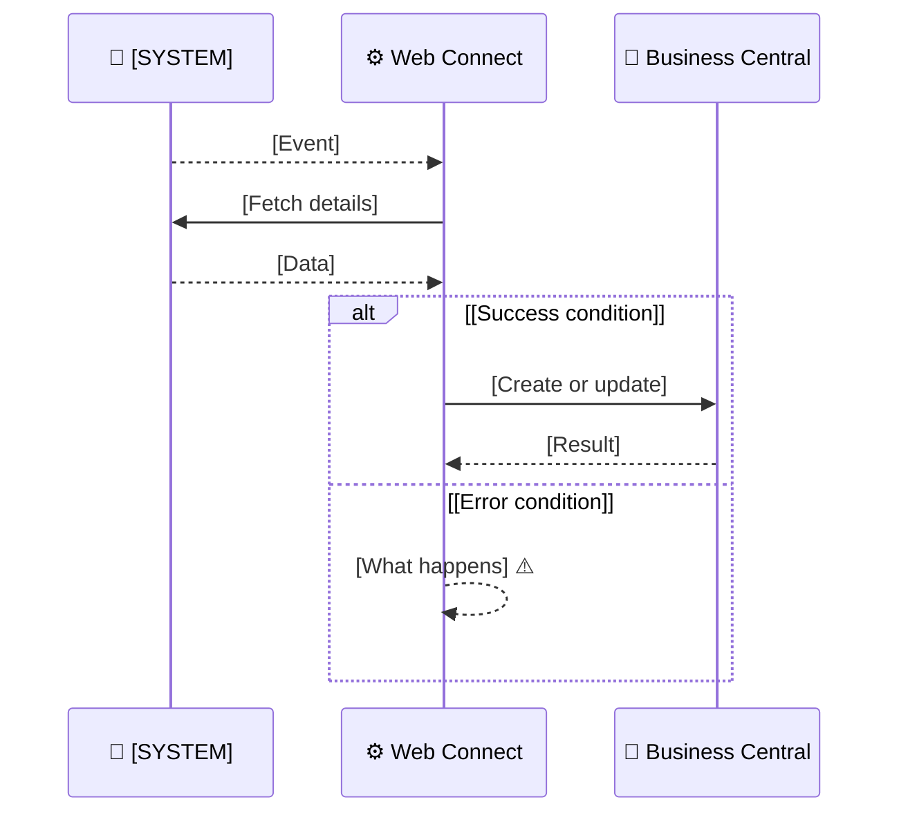

# [SYSTEM] to Business Central: [flow name]

[Answer first, two to three sentences. Example: "When a customer places an order in Centra, Web Connect creates a sales order in Business Central and confirms the order in Centra. The flow starts from a webhook, so orders arrive within seconds."]

| | |
|---|---|
| **Direction** | [SYSTEM] → Business Central |
| **Trigger** | [Webhook, schedule or change in Business Central] |
| **Result** | [What exists afterwards in each system] |
| **Part of** | [Business Central and SYSTEM integration](../overview.md) |

## Step by step

1. [Step, with the responsible system]
2. [Step]
3. [Step]

## Data mapping

| [SYSTEM] field | Business Central field | Note |
|---|---|---|
| [field] | [field] | [Conversion or rule] |

## Web Connect objects

| Object | Role |
|---|---|
| `[OBJECT_CODE]` | [What it does] |

## Error handling

| Situation | What happens | What to do |
|---|---|---|
| [Error] | [Behaviour] | [Action, link to how-to] |

## Frequently asked questions

### [Question]

[Answer]

## Related

- [Business Central and SYSTEM integration](../overview.md)
- [Other flows]
- [How-to guides]
